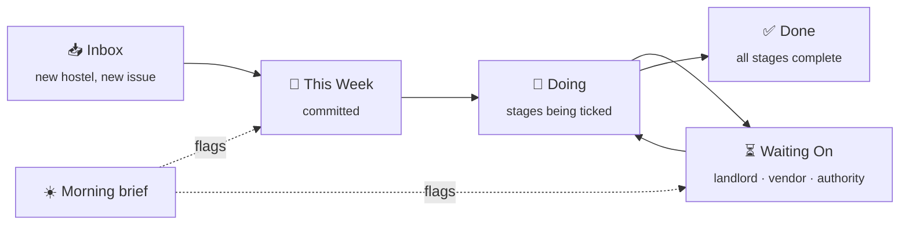
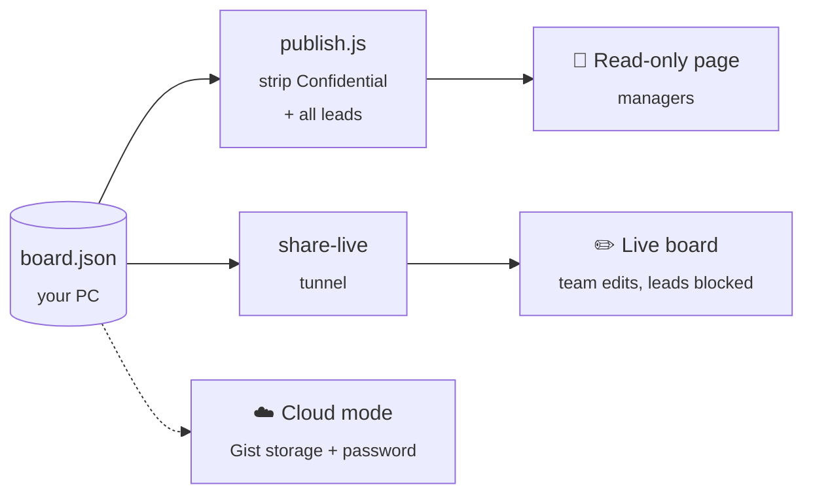

<div align="center">

# Chief of Staff

**The work tracker built for hostel & student-housing operations.**
A Trello alternative that speaks the industry's language: every hostel is a card, every
launch step is a stage, and managers get a live, read-only view of where each property stands.


<br>

<a href="#why-not-trello"><b>Why not Trello</b></a> ·
<a href="#built-for-hostel-operations"><b>Features</b></a> ·
<a href="#share-it-with-your-managers"><b>Share with managers</b></a> ·
<a href="#get-started-in-60-seconds"><b>Get started</b></a>

<br>


<sub>▲ The ops board, then the manager's read-only view · demo data, fictional hostels</sub>

<br>

| 🏠 **One card per hostel** | ✅ **Stages, not just tasks** | ⏳ **Waiting-on tracking** | 👀 **Manager share link** | 🔒 **Confidential stays private** |
|:---:|:---:|:---:|:---:|:---:|
| signage → GMB → check-in data | progress % on every card | who's blocking, for how long | read-only, auto-grouped | never leaves your PC |

</div>

---

## Why not Trello

Generic boards make you build the process yourself, and they charge per seat for every
manager who just wants to *look*. Chief of Staff ships with the way a hostel operator
already works.

| | Trello / generic boards | Chief of Staff |
|---|---|---|
| **Structure** | Blank lists you design | Fixed flow: **Inbox → This Week → Doing → Waiting On → Done** |
| **Property rollout** | Copy a checklist into each card by hand | Each hostel card carries its own **stages** (Signage, GMB Verified, Check-in Data…) with a progress bar |
| **Blockers** | A label, if someone remembers | **Waiting on** a named person or vendor (landlord, AMC vendor, local thana), aged automatically |
| **Deadlines** | Due date | Due date **plus** a red overdue flag on the board and in the morning brief |
| **Manager visibility** | Invite, assign seat, pay | **One link**: a read-only page grouped by work stream, with done counts |
| **Sensitive work** | Same board, same permissions | Streams named *Confidential* or *Private* are stripped before anything is shared |
| **Daily follow-up** | You check the board | An automatic **morning brief**: overdue, due today, stalled > 5 days, waiting > 3 days |
| **Lead pipeline** | Separate tool | Built-in **Leads** tab (new → contacted → visited → booked), never shared |
| **Cost & data** | Subscription, their cloud | Free, runs on your PC, data is one JSON file you own |

---

## Built for hostel operations


- **Work streams** for the way an operator is organised: *Hostel Readiness, Compliance, Maintenance, Admissions, Marketing*. Click a stream to filter the board to it; add, rename or remove streams from the board itself.
- **Stages inside every card.** A new hostel isn't "done" until signage is up, the Google Business profile is verified and check-in data is digitised. Each tick moves the progress bar; the card shows `✓ 2/3` at a glance.
- **Waiting On, with names.** A card parked on *"Landlord (lease)"* or *"Otis service team"* shows who it's stuck with, and the brief nags when it's been more than 3 days.
- **Overdue in red.** Fire NOC renewals and compliance deadlines can't hide.
- **Drag and drop** between columns, or just tell Claude: *"move Oak House to doing"*, *"tick signage on Birch Villa"*.
- **Every save is backed up** first; the last 50 versions are kept.



---

## Share it with your managers


Managers don't need an account. Pick how much access they get:

| Mode | What they get | How |
|---|---|---|
| 👀 **Read-only link** | A clean page grouped by work stream: status, stage progress, due dates, who it's waiting on. *Confidential/Private* streams and all leads are removed. | `node publish.js` → hosted on GitHub Pages |
| ✏️ **Live editable link** | The real board: they can drag cards and tick stages with you, in real time. Leads stay blocked (`403`). | `share-live.bat` opens a secure tunnel from your PC |
| 📱 **Always-on cloud board** | A permanent, password-protected URL that works from any phone, PC off. | Deploy to Render, see [DEPLOY.md](DEPLOY.md) |



---

## Get started in 60 seconds

Needs [Node.js](https://nodejs.org) 18+. Nothing to install; there are zero dependencies.

```bash
git clone https://github.com/rohanxezstays/chief-of-staff.git
cd chief-of-staff
npm start
```

Open <http://localhost:4820>. The first run creates your board from a starter template.

<details>
<summary><b>🪟 Install as a Windows desktop app</b></summary>

<br>

Double-click **`install-windows.bat`**. It:

1. Starts the server automatically (hidden) when you log in
2. Puts a **Chief of Staff** shortcut on your desktop that opens the board in its own app window
3. Starts the server right now

To uninstall: delete the desktop shortcut and `ChiefOfStaff-Server.lnk` from your Startup folder (`Win+R` → `shell:startup`).

On Mac/Linux: `npm start` and bookmark <http://localhost:4820>.

</details>

<details>
<summary><b>💬 Run it by chat with Claude</b></summary>

<br>

Open this folder in [Claude Code](https://claude.com/claude-code). [CLAUDE.md](CLAUDE.md) teaches Claude the board's rules, so plain words work:

| You say | It does |
|---|---|
| "add Cedar Residency to hostel readiness" | New hostel card with the standard stages |
| "tick check-in data for Birch Villa" | Ticks that stage, updates progress |
| "I'm waiting on the landlord for Elm Court's lease" | Moves the card to Waiting On, names the blocker |
| "what's stalled?" | Cards in Doing / This Week untouched for 5+ days |
| "publish the board" | Refreshes the managers' read-only link |
| "join my meeting" | Takes notes from a Google Meet and drops action items in Inbox |

</details>

<details>
<summary><b>☀️ The morning brief</b></summary>

<br>

```bash
npm run brief
```

Writes `briefs/YYYY-MM-DD.md`: overdue first, then due today, stalled work (> 5 days untouched),
and blockers waiting > 3 days, plus the leads pipeline. Schedule it with Claude Code to get the
top three items every morning.

</details>

<details>
<summary><b>🗂️ What's in the repo</b></summary>

<br>

```
server.js                zero-dependency Node server + board API (port 4820)
dashboard/               the board UI (vanilla JS, no build step)
publish.js               builds the managers' read-only page
share-live.bat           live editable link via tunnel
render.yaml, DEPLOY.md   always-on cloud mode (Render + GitHub Gist)
generate-brief.js        morning brief
data/board.example.json  starter template (your board.json is never committed)
CLAUDE.md                operating manual so Claude can run the board by chat
meetings/                meeting transcripts + notes
tests/                   17 tests: API, backups, validation, brief rules
```

</details>

---

<div align="center">
<sub>Built at <b>Next 2 Door Living</b> (EzStays · Basecamp) to run a multi-city hostel rollout · screenshots show demo data only · MIT licensed</sub>
</div>
